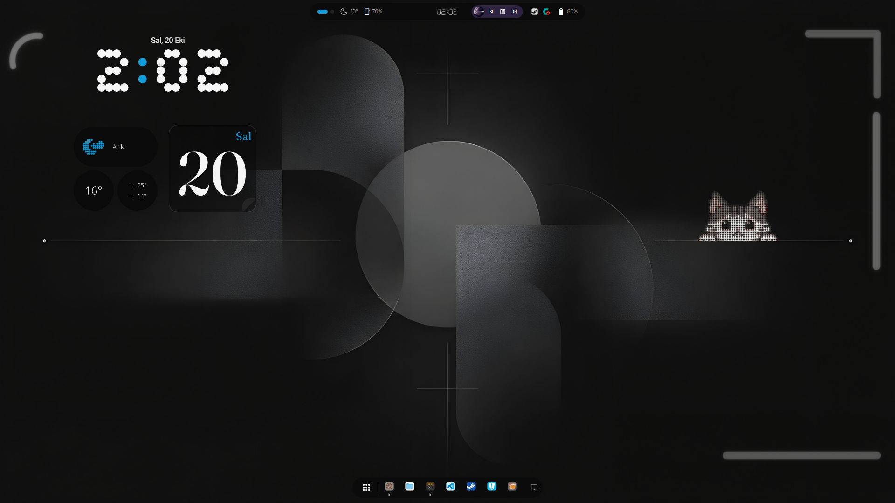
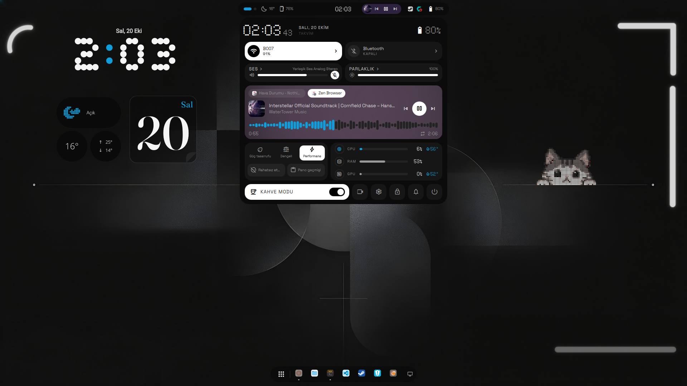

# Nothing KDE

A Nothing-inspired Plasma 6 theme suite with a top island, bottom dock, fifteen desktop widgets,
Glassy application styling, and optional application accent integrations. The UI is localized
in Turkish and English; no custom daemon is required.

<table>
  <tr>
    <td width="50%"></td>
    <td width="50%"></td>
  </tr>
  <tr>
    <td align="center"><sub>Desktop: island, widgets and dock (dots mark apps open on another virtual desktop)</sub></td>
    <td align="center"><sub>Expanded island: connectivity, media, power profiles and system stats</sub></td>
  </tr>
</table>

## Install

Requires Plasma 6.7, Qt 6.10+, Bash, Python 3, `kpackagetool6`, `qdbus6`, and KDE
package/configuration tools.

Island controls use Plasma's own components, so they behave like Plasma's applets:
plasma-nm (Wi-Fi, hotspot, airplane mode), plasma-pa (volume, microphone, recording
indicator), bluez-qt (Bluetooth), PowerDevil (battery, every display's brightness, keyboard
backlight), libksysguard (CPU/RAM/GPU) and plasma-workspace (notifications, calendar).
KDE Connect is optional (phone battery) and `powerprofilesctl` switches power profiles.
`install.sh` warns when a component is missing.

```sh
git clone https://github.com/Contraill/Nothing-Kde-Theme.git
cd Nothing-Kde-Theme
./install.sh                  # install / upgrade
./install.sh --apply-layout   # create/repair the two panels; Plasma is reloaded
./install.sh --widgets-only   # desktop widgets only
```

Choose **Nothing KDE** (dark) or **Nothing KDE Light** in System Settings. Add the desktop
widgets through **Add Widgets**; most offer several styles in their settings: clocks (analog,
digital and world, large), date and calendar, weather (Open-Meteo), media, photo, devices and
battery, **System Monitor** (dot rings, dotted bars with the disk, or a pill), **Note** (saves
as you type, or a mantra pill), **Focus Timer** (pomodoro that survives restarts and notifies
with Plasma's timer sound), **Phone** (the KDE Connect phone's battery, ring and open),
**Progress** (the year as a dot ring, or day, week, month and year bars), **Quick Toggles**
(Wi-Fi, Bluetooth, airplane mode and volume, or a volume pill) and **Trash** (item count and
size; click to open).

### Boot login wallpaper (Plasma Login Manager)

The boot login screen has separate system-wide settings from the desktop and lock screen.
On systems using **Plasma Login Manager**, apply Nothing's wallpaper explicitly:

```sh
./install.sh --login-wallpaper dark   # or light; asks for administrator authentication
```

The selected image appears at the next boot login. To undo only this setting, run
`./install.sh --login-wallpaper remove`.

This installs public image copies and a wallpaper-only configuration drop-in. It does not
change authentication, auto-login or the running session. Existing administrator settings
in `/etc/plasmalogin.conf` retain precedence, including custom wallpaper choices. The boot
wallpaper is a fixed selection; changing a user's desktop mode does not change the shared
login screen. Uninstall removes the optional integration and exposes the previous settings;
files edited after installation are preserved with an error rather than overwritten.
SDDM uses a different configuration and is not changed by this command.

Desktop widgets share a palette-driven Glassy surface; images and artwork keep their own
content. Normal desktop applets share the wallpaper's window, so the widget surface uses
translucency rather than fake blur or an external effect
([KDE desktop view](https://invent.kde.org/plasma/plasma-workspace/-/blob/master/shell/desktopview.cpp)).

Existing panels are retained. `--apply-layout` creates a backup first and removes only
retired Nothing side panels.

## Splash and boot animation

Both show the same ring of dots: a comet in the KDE accent circles, then the ring fills.
The Plasma splash is a single entry, **Nothing KDE**, used by the light and dark themes and
drawn in the active colours.

The boot animation is a Plymouth theme drawn by `runtime/bootsplash.py` (no foreign
images). Installing needs the administrator password once:

```sh
./install.sh --boot-splash install   # or remove; rebuilds the initramfs
```

It installs a root-owned helper and a polkit rule that lets the active session recolour the
boot animation, and nothing else, without a password: when the KDE accent changes, the
island redraws it and rebuilds the initramfs in the background with the distribution's own
`plymouth-set-default-theme -R`. Removing restores the previous Plymouth theme.

## Sounds

The **Nothing KDE** sound theme is a set of short digital dots synthesised by
`assets/sounds/build-sounds.py` (original work, no recordings). Installing selects it when no
other sound theme was chosen, and the Nothing global themes select it too; change it under
**System Settings → System Sounds**. Events it does not cover fall back to the freedesktop
theme.

Your own recordings (for example from a Nothing phone's Glyph Composer) can replace any event
on your machine only. Name each file after the event (`message-new-instant.wav`) or an alias
(`notification`, `alarm`, `ringtone`, `charging`, `unplug`, `connect`, `disconnect`, `error`,
`warning`, `startup`, `shutdown`, `volume`, …) and run:

```sh
./install.sh --sounds import ~/Recordings/glyph   # builds "Nothing KDE (personal)" and selects it
./install.sh --sounds use nothing                 # or personal | default
```

The recordings are converted into `~/.local/share/sounds/nothing-kde-personal` and never
copied into the project; missing events fall back to the bundled theme.

## Glassy

The bundle includes the reusable **Glassy** Kvantum theme and native **Glassy** Aurorae
window decoration. Both follow KDE colors and do not depend on the Nothing palette.
Select `Kvantum` as the KDE application style and `Glassy` in Kvantum Manager; the window
decoration is also named `Glassy`.

**Glassy Settings** is available from the application launcher. The Application, Glass,
Window Decoration, and Controls tabs share the same `auroraerc` /
`[org.glassy.decoration]` configuration. **Reset to Glassy defaults** resets only this form,
and changes are staged until **Apply**. The same settings form is available under
**System Settings → Window Decorations → Glassy → Configure**.

The small native settings utility requires CMake/C++ when built from source; it is not a
style engine.

```sh
./install.sh --appearance install     # Glassy only
./install.sh --appearance sync        # after palette changes
./install.sh --appearance disable     # restore previous selections
```

Installed dependencies are reused and uninstalling never removes packages. Ownership and
previous appearance selections are recorded in:

```text
~/.config/nothing-kde/appearance/state.json
```

The island triggers palette synchronization. If Glassy is used with another theme or panel,
connect `sync` to that theme's color change path. There is no separate daemon.

Glassy targets Qt Widgets. System Settings' Qt Quick pages, GTK applications, and Electron
content are outside Kvantum's scope and may remain opaque.

Kvantum surfaces update live. Kvantum caches its SVG, so a palette change is rendered into
the inactive one of two identical Glassy style slots (`kvantum` / `kvantum-dark`) and KDE is
switched to it; running Qt applications reload the style without being restarted. See the
[live-palette notes](assets/kvantum/LIVE-PALETTE.md) and
[Glassy integration notes](assets/kvantum/README.md). Only when Glassy runs under another
style name does a light/dark switch show one notification that open applications may need
reopening.

The window decoration offers three button styles (line, dots, traffic lights) and an
**opaque applications** list for programs that need a solid frame (Krita, OBS, Shotcut and
Kvantum's defaults out of the box). Updating the decoration reloads it in KWin.

## Optional integrations

```sh
./install.sh --dolphin apply
./install.sh --dolphin restore
./install.sh --accent-links enable fastfetch   # starship | spaceship | fastfetch | gtk
./install.sh --accent-links disable all
```

Accent links can also be managed from the island's settings. Starship/Fish and Spaceship/Zsh
need a new terminal after first enabling the integration; Fastfetch updates on its next run.
`gtk` gives libadwaita (GTK 4) applications the exact KDE accent instead of the nearest
Adwaita color; it writes a marked block into `~/.config/gtk-4.0/gtk.css`, which
kde-gtk-config leaves in place, and applies to newly opened windows.

Starship uses contrast-aware segment foregrounds and KDE palette text. The original prompt
layout/configuration is preserved, and linked colors update on the next prompt render.

Expand the island and left-click the gear for island settings; right-click it for KDE System
Settings. The island can switch Light/Dark mode and provides a visual color picker or manual
HEX input for the accent. The persistent accent source is KDE `General/AccentColor`; startup
and mode switching preserve it. Closing the picker discards unapplied changes.

**Automatic at sunrise / sunset** turns on Plasma's own automatic Global Theme switching with
the Nothing Light and Dark packages; the times come from Plasma's day/night settings
(location or fixed times). When Plasma switches, the island finishes the change for Kvantum,
wallpapers and the other panels. Choosing Light or Dark by hand turns it off.

If Kitty is installed, the integration manages Kitty's official
`light-theme.auto.conf`, `dark-theme.auto.conf`, and `no-preference-theme.auto.conf` files.
The main `kitty.conf`, opacity/blur settings, and the 16 ANSI colors are preserved. Kitty
applies OS light/dark changes live; managed file changes use the official SIGUSR1 reload path.
Processes launched with a custom `--config` are not signaled.

Restore Kitty integration with:

```sh
./install.sh --kitty-theme disable
```

Previous automatic-theme files are preserved, and files edited by the user after integration
are not overwritten. Removing automatic themes may require manually reopening Kitty to discard
its cached theme; the integration never restarts a process.
See [Kitty's official automatic themes documentation](https://sw.kovidgoyal.net/kitty/kittens/themes/#change-color-themes-automatically-when-the-os-switches-between-light-and-dark).

No icon theme is required, installed, or selected automatically. [Colloid](https://github.com/vinceliuice/Colloid-icon-theme)
is an optional recommendation because of its modern appearance, Glassy fit, and KDE
palette-aware folder tinting. Colloid's `--notint` option disables its KDE tint support.

**Confirm power actions** is enabled by default in island settings. Disabling it removes only
the panel's own confirmation step; KDE/Polkit rules are unchanged. The preference is stored in
panel configuration and applies to the panel's power actions, including suspend.

### Manual persistence check

Choose a different accent and Light/Dark mode, change the Glassy radius/bottom-corner setting,
and toggle panel power confirmation. First log out and back in, then reboot when convenient and
confirm that the same values remain.

When power confirmation is disabled, actions can execute immediately, so test only after saving
your work. Automated tests do not execute real shutdown, logout, or suspend operations.

### Dolphin

The Dolphin profile follows KDE colors and uses a scoped Qt stylesheet rather than a global
style. Launch Dolphin from the dock/menu to ensure the Qt style is loaded; a first launch
directly through a terminal or D-Bus can bypass that startup path. Personal folder settings are
preserved.

Backups for reversible application links live in `~/.config/nothing-kde/`; do not delete them
while an integration is enabled. Use `--dolphin status` or `--accent-links status` to inspect
their state.

### Limine

Limine 12 integration is export-only; boot files are never modified:

```sh
./install.sh --accent-links export limine \
  --source /path/limine.conf \
  --output /tmp/limine-preview.conf
```

## Notifications and privacy

The optional Glyph notification adapter checks the installed KDE notification QML/API
structure rather than requiring an exact Plasma patch version. It verifies notification
resources, model callbacks, and popup APIs. If compatibility cannot be established, the
native KDE notification appearance is retained.

Compatibility inspection uses a temporary Qt 6 probe and therefore needs a C++ compiler,
`pkg-config`, and Qt Core/Qml/Gui headers. If those tools are missing, the optional skin is
safely skipped.

Install the notification appearance with:

```sh
./install.sh --notifications-only --restart-plasma
```

Explicitly override only the compatibility gate with:

```sh
./install.sh --notifications-only --force-notifications --restart-plasma
```

`--force-notifications` bypasses compatibility detection only. QML validation, local service
checks, and rollback remain active. No notification daemon or system KDE resource is replaced.

Restore the previous notification appearance with:

```sh
./notification-skin/rollback-native.sh
```

The camera button in the island's bottom row blocks USB Video interfaces; reconnecting or
rebooting may reset it. Blocking normally asks for the administrator password. A one-time
setup removes that prompt for blocking only:

```sh
./install.sh --privacy-helper install   # or remove; asks for the password once
```

It installs a root-owned copy of the helper and a polkit rule that lets the active local
session run exactly `camera off` without a password. Allowing the camera again still asks,
so a program running as you cannot quietly turn it back on.

The island's microphone button is a software mute of the default input. The older ALSA
capture block is still available from the command line (it denies local capture devices,
persists across reboot and briefly restarts audio services; Bluetooth, virtual, network and
OSS capture are outside its scope). While that block is active, the microphone button turns
red and lifts it with administrator approval.

Privacy controls require Polkit, ACL tools, udev, systemd, and PipeWire/WirePlumber.

**Unblock the microphone before uninstalling:**

```sh
pkexec /usr/bin/python3 -I "$PWD/runtime/privacy.py" microphone on
./uninstall.sh
```

Store-only recovery helper:

```text
~/.local/share/plasma/plasmoids/com.nothingplasma.panel/contents/tools/privacy.py
```

## Island and dock

The compact island shows workspaces, weather, the clock, media, and live activities: file
transfer progress, a microphone-in-use dot and the phone's battery from KDE Connect. Volume,
mute and microphone changes briefly replace the clock (Plasma's own audio OSD is turned off
while this is enabled). Workspaces, weather, clock, player, network, volume, battery and
phone can each be hidden in island settings.

The expanded island's cards open detail pages with the chevron or a right-click: Wi-Fi
(join, forget, share as QR code, hotspot, airplane mode), Bluetooth (pair, connect, battery),
output and input device selection with both volumes and a live microphone level, and
brightness for every display plus the keyboard. Hovering the battery shows the remaining time and battery health.

Notifications support actions, inline replies and grouping by application. Do Not Disturb
stays on until it is turned off. The calendar marks holidays (Plasma's holiday regions) and,
optionally, moon phases.

Click the island weather area to choose a city or refresh the data. Open-Meteo receives the
city search/coordinates and your IP; no API key is needed.
[Weather data](https://open-meteo.com/) uses CC BY 4.0. The selected location is stored in
panel configuration.

Launcher settings list installed applications; visibility choices apply to this launcher and
its search results.

The island's appearance settings include **Show system tray** and **Configure tray items**.
The latter opens KDE's native per-application visibility settings and remains available when
the entire tray is hidden. These choices persist in Plasma configuration; updating Nothing
does not reset an existing tray. Application icons appear between the player and battery.

Meta+1 … Meta+9 open or cycle the dock's applications, the mouse wheel cycles an icon's
windows, and dropping files on an icon opens them with that application. Icons show unread
notification badges (following Plasma's task-manager badge settings), a progress ring for
running transfers and a window count. Launcher settings can limit the dock to the current
desktop or screen. The launcher's top row lists the most used applications, and typing
anywhere starts a search.

Middle-click a window preview to close that window; the application's other windows stay
open.

Drag dock icons to preview a new order; releasing commits it once. Releasing above or below
the dock cancels the move. Right-click menus include actions supplied by the application's
desktop entry, when available (for example Steam's Big Picture action).
An icon with windows on another workspace has an accent-colored dot. In the window preview,
each window on another workspace is dimmed and labeled with that workspace's name. Windows
shown on all workspaces are not marked. Right-click
the launcher's settings button to open KDE System Settings; left-click opens launcher settings.

With automatic wallpaper enabled, Nothing reapplies its light/dark pair after panel startup,
screen changes and activity changes. Custom images and other wallpaper plugins are preserved,
including overrides on previously themed screens. Empty wallpaper settings and KDE's stock
`Next` wallpaper are treated as unconfigured desktops. To deliberately keep `Next`, turn off
automatic wallpaper in Nothing's settings.

## Test and package

```sh
./validate.sh
./package.sh                           # artifacts: dist/
./package.sh --output /tmp/nothing-kde-dist
NOTHING_PACKAGE_DIR=/tmp/nothing-kde-dist ./validate.sh

# Optional native dock and notification geometry tests (require QApplication):
cmake -S tests/qml-native -B /tmp/nothing-native-tests
cmake --build /tmp/nothing-native-tests
NOTHING_NATIVE_QML_RUNNER=/tmp/nothing-native-tests/nothing-native-quick ./validate.sh
```

Qt QML tools enable lint and interaction tests.

Translations are gettext catalogs in `po/`: `po/panel` for the island and dock (the
`msgctxt` is the key the QML passes to `Cfg.t()`, the `msgid` the English text) and
`po/widgets` for the desktop widgets. After editing, run `python3 po/build.py`; it checks
the files with `msgfmt`, writes the island's `Translations.js` and the widgets' `.mo`
catalogs, and `--check` verifies without writing. A new language is a new `<lang>.po`; the
island's language setting lists every catalog, and "System language" picks the KDE
language when a catalog exists for it. Pinned KDE sources and compiled translations are retained for offline packaging.

Store dependencies can be prepared with:

```sh
./package.sh --store-ids packaging/store-ids.json
```

Use the structure in `packaging/store-ids.example.json` and real published component IDs.

**Store publication is not yet cleared.** Widget font/artwork permissions, wallpaper
redistribution rights, and real Store IDs must be resolved first.

License and attribution:
[GPL](LICENSE),
[Island attribution](plasmoids/com.nothingplasma.panel/contents/island/NOTICE.md),
[widget sources](widgets/UPSTREAM.json), and each widget's `UPSTREAM-NOTICE.md`.

Existing `com.nothingplasma.*` IDs remain stable to preserve panels and pinned applications.
