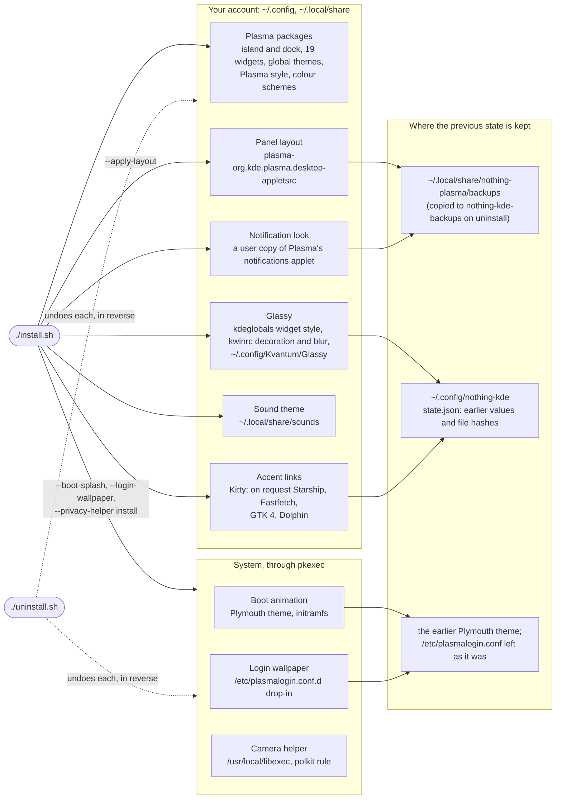

# What the installer changes, and how it comes back

Nothing KDE runs no daemon of its own: it installs Plasma packages and writes settings, and
every change has its way back. Most of it stays in your account; three optional parts need
the administrator password once.

| Change | Undo on its own | The earlier state |
| --- | --- | --- |
| Plasma packages, colour schemes | `./uninstall.sh` | nothing replaced; only our own files |
| Panel layout | restore `plasma-org.kde.plasma.desktop-appletsrc` from the backup | `nothing-plasma/backups/layout-*` |
| Glassy | `./install.sh --appearance disable` | previous style, decoration and blur in `nothing-kde/appearance/state.json` |
| Notification look | `./notification-skin/rollback-native.sh` | `nothing-plasma/backups/native-notifications-*` |
| Sound theme | `./install.sh --sounds use default` | chosen only when no other theme was |
| Accent links, Dolphin | `--accent-links disable all`, `--dolphin restore` | `nothing-kde/accent-links`, `nothing-kde/dolphin` |
| Kitty | `./install.sh --kitty-theme disable` | `nothing-kde/kitty-theme/state.json` |
| Boot animation | `./install.sh --boot-splash remove` | the earlier Plymouth theme, initramfs rebuilt |
| Login wallpaper | `./install.sh --login-wallpaper remove` | `/etc/plasmalogin.conf` is never edited |
| Camera helper | `./install.sh --privacy-helper remove` | nothing replaced |

Three rules hold throughout:

- **Owned files only.** What Glassy, the login wallpaper, Kitty and Dolphin write is recorded
  with its hash; a file you edited afterwards is kept and reported, never overwritten or
  removed. The accent links back up each file before they change it.
- **Packages stay.** On Arch, Glassy installs Kvantum or Aurorae through pacman only when
  missing; elsewhere it takes what is installed, and without them the rest installs without
  Glassy. No step ever removes a package.
- **Uninstall stops when it must.** It refuses to run while the command-line ALSA microphone
  block is on, since the helper that lifts it is removed with the rest.
